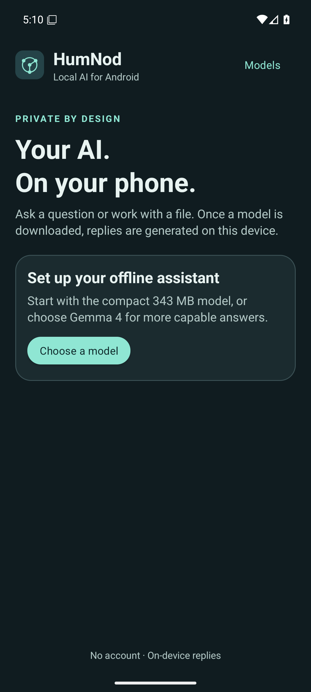
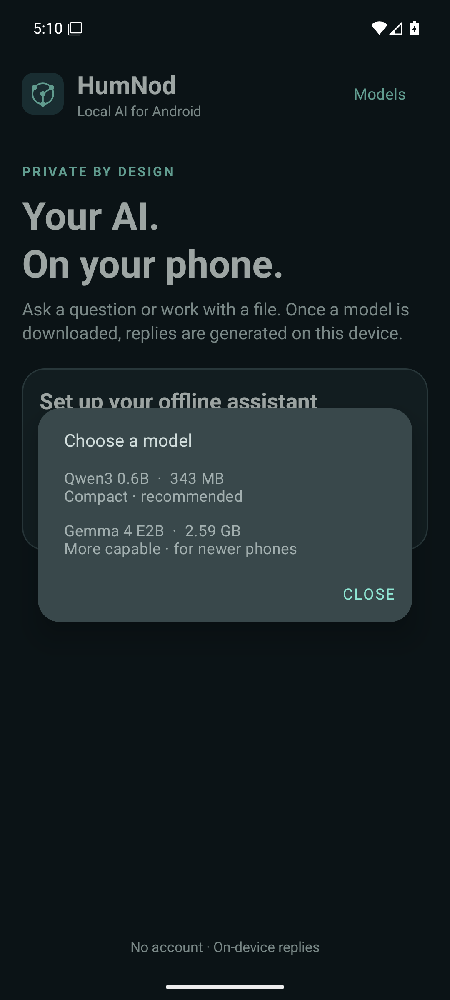
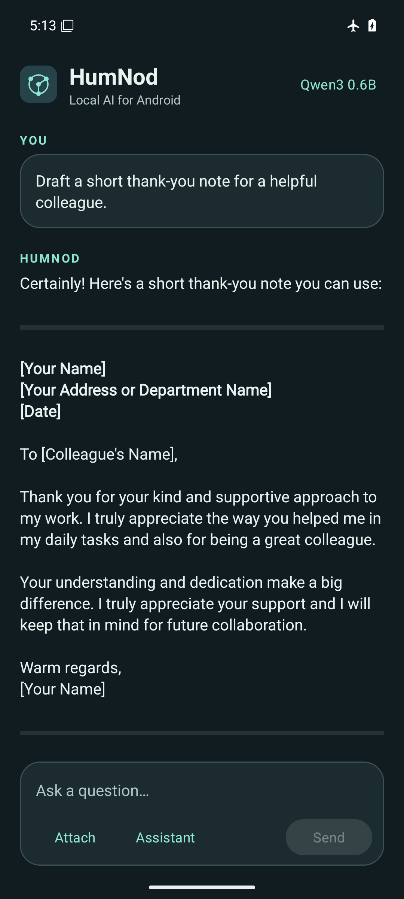

# HumNod

**Offline AI for Android.** Draft a message, ask a question, or summarize part of a file using a language model that runs on your phone.

[Quick start](#quick-start) · [Models](#models) · [Files and privacy](#files-and-privacy) · [Build from source](#build-from-source) · [Report an issue](https://github.com/arpanjot-coding/HumNod-Android/issues)

<p align="center">
  
  
  
</p>
<p align="center"><sub>Setup, model selection, and a sample offline reply on the Android 16 emulator.</sub></p>

## Quick start

You'll need a 64-bit Android phone running Android 9 or later and enough free storage for your chosen model.

1. [Build and install the debug APK](#build-from-source).
2. Open HumNod and tap **Choose a model**. **Qwen3 0.6B** is a good first choice if you're unsure how much memory your phone has.
3. Confirm the download and keep HumNod open until the model is ready. You can then turn off your connection and send a prompt.

Tap **Assistant** in the composer to choose an Assistant or Academic response style, with concise and detailed options for each. Each prompt starts a fresh exchange. Use **Copy reply** to save a result elsewhere.

## Models

- **Qwen3 0.6B · 343 MB.** The compact option for short questions, rewrites, and quick drafts. [Model card](https://huggingface.co/litert-community/Qwen3-0.6B)
- **Gemma 4 E2B · 2.59 GB.** The more capable option for longer explanations and more demanding prompts. [Model card](https://huggingface.co/litert-community/gemma-4-E2B-it-litert-lm)

Both models run on the CPU using LiteRT-LM. The sizes above are download sizes. Memory use and speed depend on your phone. Tap the model name at the top of the screen to switch models or remove a download. [LiteRT-LM](https://github.com/google-ai-edge/LiteRT-LM)

## Files and privacy

Use **Attach** to select a text or Markdown file, a PDF with selectable text, or a photo of readable text. HumNod extracts a short excerpt and includes it in your prompt. For photos, it uses on-device text recognition.

HumNod processes prompts, extracted text, and replies on your device. It needs an internet connection to download a model from Hugging Face and verifies the file against its expected SHA-256 before loading it. HumNod requires no account or API key and keeps no chat history.

## Build from source

Use Android Studio with JDK 17 or later and Android SDK Platform 36. The Gradle wrapper downloads the build dependencies.

```sh
git clone https://github.com/arpanjot-coding/HumNod-Android.git
cd HumNod-Android
./gradlew :app:assembleDebug
adb install -r app/build/outputs/apk/debug/app-debug.apk
```

On Windows, run `.\gradlew.bat :app:assembleDebug` in PowerShell. You can also open the project in Android Studio and choose **Run**. The APK includes ARM64 and x86-64. Run `:app:lintDebug` with the same Gradle wrapper to check the Android project.

## Troubleshooting

- **Download interrupted.** Tap **Try again**, or select the same model and tap **Resume**. HumNod keeps the partial download so it can continue.
- **Gemma 4 is slow or won't load.** Try Qwen3 0.6B. It is the better starting point on phones with limited memory.
- **Upgrading from the Phi-3 version.** Download a new model from the picker. If you want to recover storage from the old model, clearing HumNod's storage in Android Settings also resets its settings and removes downloads.

If you find a bug, include your phone model, Android version, selected model, and the steps to reproduce it. Remove private prompts and file contents from anything you share. [Open an issue](https://github.com/arpanjot-coding/HumNod-Android/issues)
