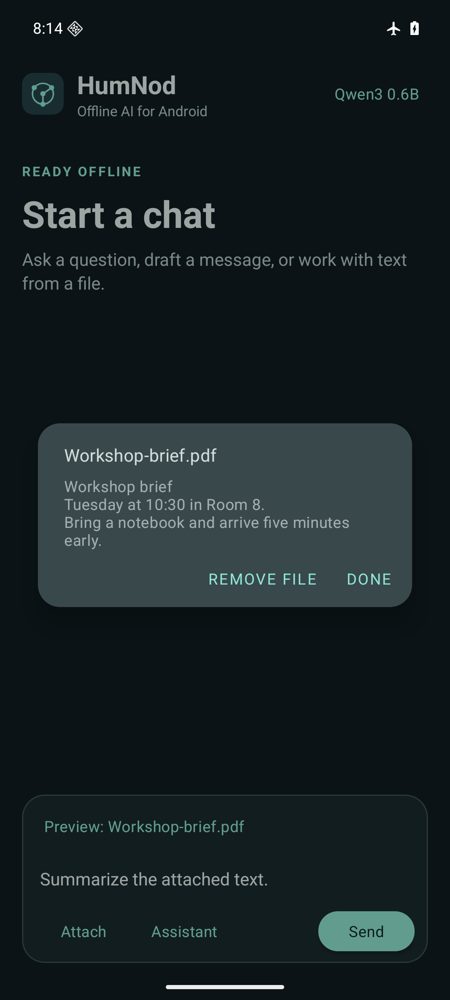

<p align="center">
  
</p>

<h1 align="center">HumNod</h1>
<p align="center">Draft, ask, and work with files using AI that runs on your Android phone.</p>
<p align="center">
  <a href="#quick-start">Quick start</a> ·
  <a href="#models">Models</a> ·
  <a href="#files-and-privacy">Files and privacy</a> ·
  <a href="#build-from-source">Build from source</a> ·
  <a href="https://github.com/arpanjot-coding/HumNod-Android/issues">Report an issue</a>
</p>

## A look inside

<p align="center">
  
  &nbsp;
  
  &nbsp;
  
</p>
<p align="center"><sub>Actual HumNod screens captured on Android 16. The chat and PDF use sample content.</sub></p>

## Quick start

1. [Build and install the debug APK](#build-from-source) on a 64-bit phone running Android 9 or later.
2. Open HumNod, choose a model, and confirm the download. **Qwen3** is the starting point for everyday use. **SmolLM2** takes up the least space.
3. Once the model is ready, send a prompt or tap **Summarize a file**. You can use HumNod in airplane mode after setup.

The composer offers concise and detailed replies in Assistant and Academic styles. Each prompt starts a fresh exchange. Use **Copy reply** to save a result elsewhere.

## Models

- **SmolLM2 135M · 143 MB.** The smallest option for simple prompts. Use Qwen3 or Gemma 4 for detailed instructions or work with files. [Model card](https://huggingface.co/litert-community/SmolLM2-135M-Instruct)
- **Qwen3 0.6B · 343 MB.** The recommended choice for everyday questions, edits, and drafts. [Model card](https://huggingface.co/litert-community/Qwen3-0.6B)
- **Gemma 4 E2B · 2.59 GB.** The more capable choice for demanding prompts on phones with storage and memory to spare. [Model card](https://huggingface.co/litert-community/gemma-4-E2B-it-litert-lm)

The figures are download sizes. Models run on the CPU, and speed and memory use vary by device. Tap the active model name to switch models, resume a download, or remove a model. [LiteRT-LM runtime](https://github.com/google-ai-edge/LiteRT-LM)

The ARM64 debug APK is about 62 MB. See the [performance notes](docs/performance.md) for emulator timings, package sizes, and file processing changes.

## Files and privacy

**Attach** accepts plain text, Markdown, PDFs with selectable text, and photos of text. Tap the attached filename to review the exact excerpt before you send it. HumNod uses up to 1,800 characters and searches the first 12 pages of a PDF for text. Photos are read with on-device text recognition.

Prompts, extracted text, and replies are processed on your device. HumNod keeps no chat history and requires no account or API key. An internet connection is used to download model files from Hugging Face. Each download is verified against a pinned SHA-256.

## Build from source

Use Android Studio with JDK 17 or later and Android SDK Platform 36.

```sh
git clone https://github.com/arpanjot-coding/HumNod-Android.git
cd HumNod-Android
./gradlew :app:assembleDebug
adb install -r app/build/outputs/apk/debug/app-arm64-v8a-debug.apk
```

On Windows, run `.\gradlew.bat :app:assembleDebug` in PowerShell. For an x86-64 emulator, install `app-x86_64-debug.apk` from the same output folder. Run `:app:lintDebug` with the Gradle wrapper to check the Android project.

## Troubleshooting

- **Download interrupted.** Tap **Try again**, or select the same model and tap **Resume**.
- **A model is slow or fails to load.** Try Qwen3 or SmolLM2 and close other memory-intensive apps.
- **A file has no readable text.** Use a PDF with a text layer or a clear photo of the relevant section. HumNod accepts PDFs up to 32 MB and photos up to 24 MB.
- **Upgrading from Phi-3.** Choose a new model in HumNod. Clearing HumNod's storage from Android Settings removes old model files, current downloads, and saved preferences.

When filing an issue, include your Android version, phone model, selected model, and steps to reproduce. [Open an issue](https://github.com/arpanjot-coding/HumNod-Android/issues)
